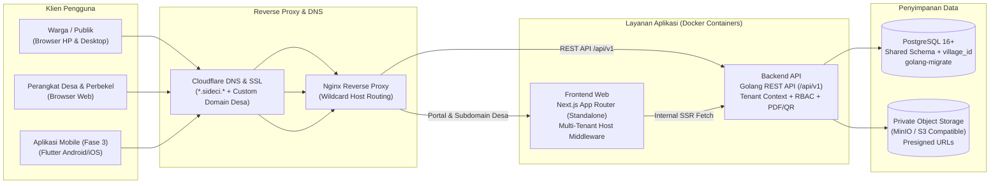

# System Architecture — SIDECI

Dokumen ini mendefinisikan arsitektur teknis **SIDECI (Sistem Desa Cerdas Terintegrasi)**. Konfigurasi port, domain, dan host merujuk langsung ke [../infra/config.yaml](../infra/config.yaml) sebagai satu-satunya sumber otoritatif.

---

## 1. Gambaran Arsitektur Tingkat Tinggi



---

## 2. Tumpukan Teknologi & Keputusan Arsitektur (ADR)

| Komponen | Pilihan Teknologi | Alasan Teknis |
| :--- | :--- | :--- |
| **Frontend Web** | **Next.js 15 (App Router, TypeScript, Tailwind CSS)** | Mendukung *Server-Side Rendering (SSR)* untuk SEO & OpenGraph unik tiap desa, serta *Middleware* pembacaan header `Host` untuk multi-subdomain & custom domain tanpa build ulang per desa. |
| **Backend API** | **Golang 1.23+ (`net/http` / `chi`, `pgx/v5`)** | Performa tinggi, jejak memori sangat kecil di VPS Docker (~20–40 MB RAM), *type-safe*, dan kontrak REST JSON siap dikonsumsi langsung oleh **Flutter Mobile** di Fase 3. |
| **Database** | **PostgreSQL 16+** | Mendukung `UUID`, `JSONB` (untuk payload dinamis 5+ jenis surat dan *before/after diff* validasi dusun), serta indeks pencarian cepat `pg_trgm` untuk ribuan NIK/Nama. |
| **Migrasi Skema DB** | **`golang-migrate`** (`backend/migrations/*.sql`) | Menggantikan rencana awal `Alembic` (Python) agar seluruh backend murni satu ekosistem Golang tanpa dependensi runtime Python. |
| **Arsip Dokumen** | **S3-Compatible Private Bucket** | Menggantikan penyimpanan folder publik lama agar scan KTP/KK dan PDF surat bertanda tangan terlindungi oleh *short-lived presigned URL*. |

---

## 3. Desain Multi-Tenancy & Isolasi Data Desa

1. **Resolusi Tenant (`Path-Prefix` Produksi & `Custom Domain`)**:
   - **Standar Produksi (`Path-Prefix`)**: Pada deployment produksi `sideci.reisys.id`, URL publik desa menggunakan pola path **`https://sideci.reisys.id/<slug>`** (contoh: **`https://sideci.reisys.id/ringdikit`**). Next.js App Router (`/[villageSlug]/...` atau Middleware) mengekstrak `<slug>` dari segmen path pertama dan meneruskannya ke Backend Golang melalui header `X-Village-Slug` / parameter path tervalidasi.
   - **Dukungan Custom Domain & Dev Lokal**: Backend `TenantMiddleware` tetap mendukung resolusi melalui `villages.custom_domain` (mis. `ringdikit.desa.id`) maupun header `X-Village-Slug` / `Host` lokal, mencocokkannya ke tabel `villages` (di-*cache* di memori dengan TTL singkat), lalu menyuntikkan `village_id` ke dalam konteks request.
2. **Isolasi Data Ketat (`Mandatory Tenant Scoping`)**:
   - Seluruh tabel operasional (`dusuns`, `users`, `households`, `residents`, `population_submissions`, `population_events`, `letter_templates`, `letter_requests`, `audit_logs`) wajib memiliki kolom `village_id UUID NOT NULL` dengan *composite index* diawali `village_id`.
   - Pengguna dengan role `kepala_dusun` mendapatkan pembatasan lapis kedua (`WHERE village_id = $1 AND dusun_id = $2`) yang ditegakkan langsung di middleware/service Golang, bukan sekadar disembunyikan di UI.

---

## 4. Desain Autentikasi, Multi-Role RBAC & Keamanan Publik

1. **Autentikasi Staf & Eksekutif**:
   - Menggunakan **JWT Access Token** berumur pendek (dikirim via `HttpOnly, Secure, SameSite=Lax` cookie untuk web dan header `Authorization: Bearer` untuk integrasi mobile masa depan) dipadukan dengan **Refresh Token** terotasi.
   - Klaim token memuat: `sub` (`user_id`), `village_id`, `dusun_id` (opsional), dan array `roles` (contoh: `["operator_kependudukan", "operator_persuratan"]`).
2. **Keamanan Endpoint Publik Tanpa Login (UU PDP)**:
   - Pengajuan surat publik (`POST /api/v1/public/letters`) dan pelacakan tiket (`POST /api/v1/public/letters/track`) tidak pernah mengekspos pencarian bebas biodata penduduk.
   - Server memvalidasi kecocokan eksak pasangan `(village_id, nik, birth_date)`, menerapkan *rate limiting* per IP, dan hanya mengembalikan nama yang telah disamarkan (`K***** R*** G******`) beserta status tiket.
3. **Verifikasi Keaslian Surat Hybrid (`QR Token`)**:
   - Setiap surat yang diterbitkan memiliki `verify_qr_token` kriptografis acak (128-bit hex/base62) yang mengarah ke `/verify/{token}`. Halaman verifikasi menampilkan keabsahan nomor surat, tanggal terbit, jenis surat, pejabat penandatangan, dan inisial pemohon resmi.

---

## 5. Struktur Modul Kode

### 5.1. Backend (`backend/`)
```text
backend/
├── cmd/api/main.go                 # Entrypoint HTTP server & graceful shutdown
├── internal/
│   ├── config/                     # Pembacaan variabel environment & validasi konfigurasi
│   ├── domain/                     # Entitas bisnis, enum status, dan kontrak tipe data
│   ├── middleware/                 # Resolusi tenant Host, CORS, keamanan header, sanitasi log
│   └── handler/                    # HTTP handlers (/health, /api/v1/public/*, /api/v1/executive/*, dll.)
├── migrations/                     # File SQL berurutan untuk golang-migrate (.up.sql & .down.sql)
└── Dockerfile                      # Multi-stage build menghasilkan binary statis ringan non-root
```

### 5.2. Frontend (`frontend/`)
```text
frontend/
├── src/
│   ├── app/                        # Next.js App Router
│   │   ├── layout.tsx              # Konfigurasi font Plus Jakarta Sans & JetBrains Mono
│   │   ├── globals.css             # Variabel token warna Civic Pop Flat
│   │   ├── page.tsx                # Portal Publik Desa (Studi Kasus Desa Ringdikit)
│   │   ├── panel/page.tsx          # Workspace Terpadu Multi-Role (Operator, Kadus, Perbekel, Superadmin)
│   │   └── verify/[token]/page.tsx # Halaman publik verifikasi QR Code keaslian surat
│   ├── components/                 # Komponen UI modular flat & kontras tinggi
│   └── lib/                        # Data mock tervalidasi Ringdikit, klien API, & utilitas masking NIK
└── Dockerfile                      # Multi-stage Next.js standalone container
```
