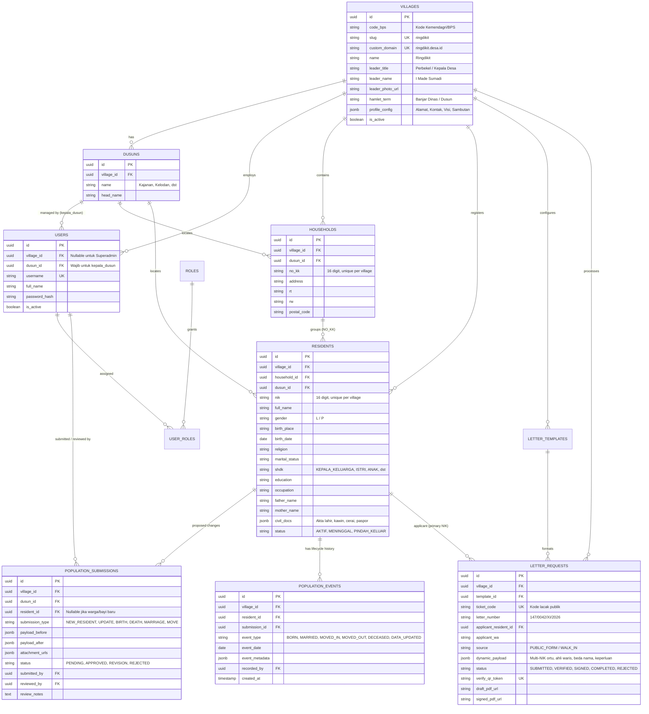

# Product Requirements Document (PRD)
# SIDECI — Sistem Desa Cerdas Terintegrasi

| Atribut Dokumen | Detail |
| :--- | :--- |
| **Nama Produk** | SIDECI (Sistem Desa Cerdas Terintegrasi) |
| **Versi Dokumen** | 1.0 (MVP Baseline — Tervalidasi) |
| **Tanggal** | 19 November 2026 |
| **Arsitektur Layanan** | Multi-Tenant SaaS Pemerintahan Desa (Subdomain & Custom Domain) |
| **Desa Percontohan (Pilot)** | Desa Ringdikit, Kec. Seririt, Kab. Buleleng, Provinsi Bali (`81153`) |
| **Tech Stack Utama** | Next.js (Web), Golang (REST API), PostgreSQL, `golang-migrate`, Flutter (Roadmap Mobile) |

---

## 1. Ringkasan Eksekutif & Visi Produk

**SIDECI (Sistem Desa Cerdas Terintegrasi)** adalah platform digital tata kelola pemerintahan dan pelayanan publik desa berarsitektur **multi-desa (*multi-tenant*)**. Melalui satu infrastruktur terpusat yang dikelola Superadmin, setiap desa mendapatkan portal informasi publik modern dengan identitas mandiri (subdomain maupun domain resmi desa) serta sistem *back-office* terpadu untuk administrasi kependudukan, pelayanan persuratan berbasis template otomatis, dan dashboard eksekutif bagi Kepala Desa/Perbekel.

Pengembangan perdana menjadikan **Desa Ringdikit (Kec. Seririt, Kab. Buleleng, Bali)** sebagai studi kasus utama dengan basis data riil sebanyak **5.393 jiwa (1.698 Kartu Keluarga)** yang tersebar di **5 Banjar Dinas/Dusun** (*Kajanan, Kelodan, Kuwum, Rawa, Sari Mekar*). Sistem dirancang fleksibel agar terminologi kearifan lokal (seperti *Perbekel* & *Banjar Dinas* di Bali maupun *Kepala Desa* & *Dusun/Lingkungan* di daerah lain) dapat dikonfigurasi per desa.

---

## 2. Evaluasi Sistem Referensi Lama & Masalah yang Diselesaikan

Berdasarkan audit terhadap basis data sistem terdahulu (`db_sideci.sql`), dataset kependudukan (`Data_Kependudukan_Desa_Ringdikit.xlsx`), dan dokumen format surat (`docs/referensi/format-surat/*.docx`), ditemukan sejumlah keterbatasan mendasar yang diselesaikan oleh SIDECI versi baru:

| Aspek | Kondisi Sistem Lama (`db_sideci` Legacy) | Solusi di SIDECI Baru |
| :--- | :--- | :--- |
| **Manajemen Peran (Role)** | Kolom `role` tunggal (`superadmin`, `admindesa`, `admindusun`, `penduduk`). Staf desa tidak bisa memiliki kombinasi kewenangan spesifik. | **Multi-Role RBAC**: Satu akun Operator Desa dapat mengemban satu atau lebih peran spesifik (mis. `operator_kependudukan` sekaligus `operator_persuratan`). |
| **Pemutakhiran & Historis Penduduk** | Perubahan langsung menimpa (*overwrite*) tabel `penduduk` tanpa jejak peristiwa kelahiran, kematian, perkawinan, atau pindah. | **Alur Berjenjang (*Maker-Checker*) & Timeline Historis**: Kepala Dusun melaporkan peristiwa/data warga dusunnya, divalidasi oleh Operator Kependudukan Desa, dan tercatat abadi di tabel riwayat mutasi per NIK & KK. |
| **Kualitas Skema & Data Kependudukan** | Seluruh 33 kolom penduduk bertipe `TEXT`; kode numerik SIAK bercampur teks (`AGAMA='4'`, `SHDRT='1'`), format tanggal ganda (`MM/DD/YYYY` & `DD-MON-YY`), serta 83 warga memiliki `id_dusun = NULL` akibat salah ketik alamat. | **Skema Ternormalisasi + Smart Excel Importer**: Validasi tipe data ketat di PostgreSQL, konversi otomatis kode SIAK saat impor Excel, *fuzzy matching* nama dusun, dan laporan anomali data (mis. KK dengan >1 Kepala Keluarga). |
| **Template & Relasi Data Persuratan** | Tabel `surat` hanya mengikat 1 `nik`, `keterangan_surat`, dan `keperluan_surat`. Padahal surat riil membutuhkan multi-entitas (NIK Ibu & Ayah pada Kelahiran, Pelapor & Almarhum pada Kematian, multi-NIK pada Ahli Waris). | **Structured Letter Engine**: Form dinamis per jenis surat dengan *auto-fill* multi-NIK, deret baris dinamis (*repeatable rows*), integrasi ke mutasi kependudukan (mis. Surat Kematian memicu draf status meninggal), serta QR Code verifikasi. |
| **Keamanan & Audit Log** | Tabel `log` mencatat *raw request payload* termasuk hash password di kolom pesan, serta tidak ada pembatasan eksposur PII yang ketat. | **Audit Trail Terstruktur & Kepatuhan UU PDP**: Pencatatan *before/after diff* yang telah disanitasi, isolasi *tenant* `village_id` berlapis, dan penyamaran (*masking*) data warga di halaman publik. |

---

## 3. Pengguna Sistem & Matriks Hak Akses (RBAC)

SIDECI memisahkan kewenangan tingkat platform dan tingkat desa (*tenant-scoped*). Akun **Operator Desa** mendukung penugasan **lebih dari satu role (*multi-role*)**.

| Aktor / Role | Lingkup Data | Hak Akses Utama |
| :--- | :--- | :--- |
| **1. Superadmin Platform** | Lintas Desa (Global) | Menambahkan/menonaktifkan desa (*tenant*), mengatur subdomain & custom domain desa, mengelola master wilayah referensi, serta membuat akun Admin awal tiap desa. |
| **2. Publik (Warga / Umum)** | Publik per Desa | Mengakses Landing Page desa & statistik agregat, mengajukan permohonan surat tanpa login (input NIK + verifikasi tanggal lahir + No. WhatsApp), melacak status surat via Kode Tiket, dan memindai QR Code keaslian surat. |
| **3. Operator Desa — `admin_desa`** | 1 Desa Penuh | Mengelola profil dasar Landing Page desa (foto Kepala Desa, sambutan, kontak, perangkat desa), daftar Dusun/Banjar Dinas, penomoran & kop surat, serta akun pengguna tingkat desa. |
| **4. Operator Desa — `operator_kependudukan`** | 1 Desa Penuh (Semua Dusun) | CRUD data KK & penduduk lintas dusun, impor/ekspor Excel, **memvalidasi (setujui/minta revisi/tolak)** laporan penduduk & mutasi dari Kepala Dusun, serta mengelola pencatatan kelahiran, kematian, perkawinan, dan pindah. |
| **5. Operator Desa — `operator_persuratan`** | 1 Desa Penuh | Memverifikasi tiket permohonan surat dari publik, membuat surat instan di loket via *auto-fill* NIK, men-generate PDF ber-QR Code, serta mengunggah PDF surat bertanda tangan basah maupun TTE BSrE. |
| **6. Operator Kepala Dusun (`kepala_dusun`)** | **1 Dusun Spesifik (`dusun_id`)** | Melihat daftar KK & warga khusus dusunnya, menginput warga baru di dusunnya, serta melaporkan peristiwa kelahiran, kematian, perkawinan, perceraian, dan perpindahan warga ke antrean validasi Desa. |
| **7. Kepala Desa / Perbekel (`kepala_desa`)** | 1 Desa Penuh (*Read-Only Eksekutif*) | Mengakses Dashboard Eksekutif visual: ringkasan demografi real-time, piramida usia, tren pertumbuhan & mutasi per dusun, performa layanan persuratan (SLA), dan kelengkapan dokumen kependudukan warga. |

> **Catatan Roadmap Mobile**: Akun login mandiri untuk warga (`penduduk`) beserta fitur KTP/KK Digital Desa tidak diaktifkan pada Web MVP untuk menjaga kesederhanaan adopsi warga desa, dan disiapkan secara khusus pada pengembangan aplikasi **Mobile Flutter** di fase berikutnya.

---

## 4. Arsitektur Multi-Desa (Multi-Tenancy & Routing URL)

1. **Skema Alamat URL Publik**:
   - **URL Produksi Berbasis Path (`Path-Based Tenant Routing` — Standar Produksi `sideci.reisys.id`)**: Saat dibawa ke produksi pada `sideci.reisys.id`, setiap desa diakses melalui pola `https://sideci.reisys.id/<slug-desa>` (contoh pilot Desa Ringdikit: **`https://sideci.reisys.id/ringdikit`**), sehingga cukup menggunakan satu sertifikat SSL/DNS `sideci.reisys.id` tanpa memerlukan wildcard DNS per desa baru.
   - **Custom Domain Desa (Opsional)**: Tetap mendukung pemetaan domain resmi milik desa (contoh: `ringdikit.desa.id` atau `desaringdikit.id`) melalui CNAME/A-Record dan resolusi header `Host` bila desa memiliki domain mandiri.
   - **Portal Pusat**: Root domain `https://sideci.reisys.id` berfungsi sebagai halaman informasi platform dan portal Superadmin.
2. **Isolasi Data Antar-Desa**:
   - Menggunakan pendekatan **Shared PostgreSQL Database, Shared Schema dengan Diskriminator `village_id` Wajib** pada seluruh tabel operasional (`dusuns`, `households`, `residents`, `population_submissions`, `population_events`, `letter_templates`, `letter_requests`, `audit_logs`).
   - Seluruh query di lapisan repository Golang wajib menginjeksi `village_id` dari konteks autentikasi/domain untuk mencegah kebocoran data lintas desa (*cross-tenant data leak*).
3. **Kustomisasi Terminologi Desa**:
   - Setiap entitas desa menyimpan konfigurasi sebutan jabatan kepala desa (default: `Kepala Desa`, opsi Bali: `Perbekel`) dan sebutan sub-wilayah (default: `Dusun` / `Kepala Dusun`, opsi Bali: `Banjar Dinas` / `Kelian Banjar Dinas`) yang otomatis diterapkan pada seluruh antarmuka web dan kop surat.

---

## 5. Kebutuhan Fungsional Detail (Cakupan MVP Fase 1)

### 5.1. Modul Landing Page & Profil Dasar Desa (Publik)
Dirancang dengan estetika pemerintahan modern, cepat diakses dari ponsel warga, dan menonjolkan transparansi data dasar desa (Studi Kasus: **Desa Ringdikit**).
- **FR-LP-01 Full-Screen Hero Carousel & Profil Pimpinan Desa**: Menampilkan *Hero Carousel* satu layar penuh (`100vh`) berisi ucapan selamat datang sebagai *hook* awal di Layanan Digital (SIDECI) Desa Ringdikit, foto potret resmi Kepala Desa/Perbekel (*I Made Sumadi — Perbekel Ringdikit*), tombol aksi cepat (*"Ajukan Surat Online"* dan *"Lihat Statistik Desa"*), serta pita atribusi **"Sistem Desa Cerdas Terintegrasi (SIDECI) — Produk Pengabdian Kepada Masyarakat - Universitas Pendidikan Ganesha"** di bagian bawah layar awal dan footer halaman.
- **FR-LP-02 Visualisasi Statistik Demografi Publik**: Menampilkan kartu metrik dan grafik interaktif yang dihitung otomatis dari data kependudukan tervalidasi (**tanpa menampilkan data pribadi/NIK**):
  - Total Penduduk Aktif, Total Kartu Keluarga (KK), serta perbandingan Laki-laki vs Perempuan.
  - Grafik sebaran penduduk per Dusun / Banjar Dinas (contoh Ringdikit: *Kajanan, Kelodan, Sari Mekar, Kuwum, Rawa*).
  - Piramida kelompok usia (Balita, Usia Sekolah, Produktif, Lansia), komposisi tingkat pendidikan, pekerjaan utama, dan agama.
- **FR-LP-03 Informasi Dasar & Wilayah Desa**: Menampilkan profil singkat desa, daftar Banjar Dinas/Dusun beserta nama Kepala Dusun/Kelian, jam operasional pelayanan kantor desa, peta lokasi sekretariat, nomor telepon/WhatsApp layanan, dan email resmi desa.

### 5.2. Modul Kependudukan, Alur Validasi Dusun-Desa & Historis
Mengelola siklus hidup data warga secara akurat dari tingkat dusun hingga tingkat desa.
- **FR-KP-01 Master Kartu Keluarga (KK) & Biodata Penduduk**:
  - Menyimpan atribut standar SIAK/Dukcapil sesuai referensi `Data_Kependudukan_Desa_Ringdikit.xlsx`: `NIK` (16 digit), `No KK` (16 digit), `Nama Lengkap`, `Jenis Kelamin`, `Tempat & Tanggal Lahir`, `Golongan Darah`, `Agama`, `Status Perkawinan`, `SHDK` & `SHDRT` (Status Hubungan Dalam Keluarga), `Pendidikan Terakhir`, `Pekerjaan`, `Kewarganegaraan`, `No Paspor & Tgl Berakhir`, `Status & Nomor Akta Lahir`, `Status/Nomor/Tanggal Akta Kawin`, `Status/Nomor/Tanggal Akta Cerai`, `Nama Ibu`, `Nama Ayah`, `Alamat`, `RT/RW`, `Dusun/Banjar Dinas`, dan `Status Penduduk` (`AKTIF`, `MENINGGAL`, `PINDAH_KELUAR`, `TIDAK_AKTIF`).
  - Validasi relasi KK: Satu `No KK` aktif idealnya memiliki tepat satu anggota berstatus `KEPALA KELUARGA`; sistem memberi peringatan (*warning*) apabila ditemukan anomali KK tanpa Kepala Keluarga atau KK dengan lebih dari satu Kepala Keluarga.
- **FR-KP-02 Operasional Kepala Dusun (Terbatas per Dusun)**:
  - Kepala Dusun hanya dapat mencari, melihat, dan mengusulkan perubahan untuk penduduk dengan `dusun_id` sesuai wilayah tugasnya.
  - Kepala Dusun dapat mengirimkan tiket usulan: **(a) Tambah Warga Baru**, **(b) Koreksi Biodata Warga**, **(c) Laporan Kelahiran**, **(d) Laporan Kematian**, **(e) Laporan Perkawinan / Perceraian / Pecah KK**, dan **(f) Laporan Pindah Masuk / Pindah Keluar**, dilengkapi unggahan foto dokumen pengantar/bukti lapangan.
- **FR-KP-03 Validasi Operator Kependudukan Desa (*Maker-Checker*)**:
  - Seluruh input Kepala Dusun masuk ke antrean `PENDING_VALIDATION` di dashboard `operator_kependudukan`.
  - Operator melihat perbandingan berdampingan (*side-by-side diff*) antara data saat ini dan usulan perubahan beserta lampiran bukti, lalu memilih:
    - **Setujui (`APPROVED`)**: Data otomatis memperbarui tabel Master Penduduk/KK dan menulis satu entri permanen ke Log Historis Penduduk.
    - **Minta Revisi (`REVISION_REQUESTED`)** atau **Tolak (`REJECTED`)**: Wajib menyertakan catatan alasan yang langsung terlihat di dashboard Kepala Dusun pengusul.
  - Input atau pencatatan peristiwa yang dilakukan langsung oleh `operator_kependudukan` di kantor desa dapat langsung disimpan sebagai `APPROVED` dengan tetap merekam jejak historis yang identik.
- **FR-KP-04 Pencatatan Peristiwa & Timeline Historis Penduduk**:
  - Setiap halaman detail warga memiliki tab **"Riwayat & Peristiwa"** yang menampilkan lini masa kronologis sejak awal tercatat, kelahiran, perubahan KK/status kawin, perpindahan antar-dusun, daftar surat desa yang pernah diterbitkan untuk NIK tersebut, hingga status kematian/pindah keluar.
  - Saat peristiwa **Kematian** divalidasi, status warga berubah menjadi `MENINGGAL` (data tidak dihapus dari database agar histori keluarga/ahli waris tetap utuh, namun otomatis dikeluarkan dari hitungan populasi penduduk aktif).
- **FR-KP-05 Smart Excel Import & Ekspor Data**:
  - Mendukung unggah file `.xlsx` dengan struktur `Data_Kependudukan_Desa_Ringdikit.xlsx`.
  - Melakukan normalisasi otomatis: pemetaan kode SIAK (`AGAMA: 1..6` ke nama agama, `SHDRT` ke `SHDK`, kode kepemilikan akta `0/1/2`), konversi tanggal multi-format (`MM/DD/YYYY HH:mm:ss` maupun `DD-MON-YY` ke `YYYY-MM-DD`), pencocokan nama dusun ke `dusun_id`, serta menampilkan *Preview & Error Report* untuk baris bermasalah (contoh: 83 baris tanpa dusun pada dataset awal Ringdikit) agar dapat diperbaiki operator sebelum disimpan.

### 5.3. Modul Persuratan Cerdas & Pengesahan Hybrid
Memangkas waktu pembuatan surat dari ketik manual belasan menit menjadi hitungan detik.
- **FR-SR-01 Pengajuan Surat Publik Tanpa Login**:
  - Warga memilih jenis surat di Landing Page desa, lalu mengisi **NIK**, **Tanggal Lahir** (sebagai verifikasi kecocokan agar pihak luar tidak bisa menebak/mengintip biodata warga hanya bermodalkan NIK), **Nomor WhatsApp aktif**, **Keperluan Surat**, field tambahan sesuai jenis surat, dan opsional foto pengantar/KTP/KK.
  - Demi perlindungan data pribadi (UU PDP), halaman publik **tidak pernah menampilkan biodata lengkap** hasil pencarian NIK; layar hanya mengonfirmasi nama yang disamarkan (contoh: `K***** R*** G******`) dan menerbitkan **Kode Lacak Tiket** (contoh: `SRT-RDK-261119-0042`).
  - Warga dapat mengecek progres tiket (`Menunggu Verifikasi` -> `Diproses` -> `Menunggu Tanda Tangan` -> `Siap Diambil / Unduh PDF`) melalui menu Lacak Surat.
- **FR-SR-02 Pembuatan Surat Efektif oleh Operator Desa**:
  - Di dashboard `operator_persuratan`, operator cukup mengetik NIK atau nama warga pada kotak pencarian cepat (*autocomplete*); seluruh variabel biodata pemohon, nomor KK, dan alamat dusun otomatis terisi (*auto-fill*).
  - Operator dapat melakukan *preview* dokumen sebelum men-generate nomor surat resmi dan file PDF.
- **FR-SR-03 Katalog Template Surat Standar (Berdasarkan Referensi Desa Ringdikit)**:
  Sistem menyediakan mesin template surat dengan kop surat dinamis per desa (Logo, Nama Kabupaten, Kecamatan, Jabatan Kepala Desa/Perbekel, Alamat, Telepon, Email) dan minimal **5 template utama siap pakai**:
  1. **Surat Keterangan Umum / Pengantar** (mencakup variasi *Keterangan Penduduk/Domisili, Pengantar SKCK/Kepolisian, Keterangan Bebas Narkoba, Keterangan Tidak Mampu/Miskin, Keterangan Usaha*): 1 NIK pemohon + dasar pengantar Kepala Dusun/Kelian + uraian keterangan + keperluan.
  2. **Surat Keterangan Kelahiran**: Data anak (nama lengkap, jenis kelamin, anak ke-, tempat & tanggal lahir, alamat), data penolong kelahiran (nama bidan/dokter & alamat), serta **auto-fill 2 NIK Orang Tua (NIK Ibu & NIK Ayah)** beserta TTL dan alamatnya. Dilengkapi tombol pintas *"Daftarkan Bayi ke Data Kependudukan"*.
  3. **Surat Keterangan Kematian**: Data pelapor (NIK/nama, alamat, hubungan pelapor), **auto-fill NIK Almarhum/ah** (termasuk No. KK, kewarganegaraan, agama, pekerjaan, alamat), detail kematian (hari, tanggal, tempat kematian, sebab kematian), serta keperluan. Dilengkapi aksi terintegrasi *"Catat Mutasi Kematian Penduduk"* agar status penduduk sinkron.
  4. **Surat Keterangan Beda Nama**: 1 NIK pemohon utama + **input baris dinamis (*repeatable documents*)** berisi daftar dokumen pembanding (`Jenis Dokumen` seperti KTP/KK/Ijazah/Akta Kelahiran, `Nomor Dokumen`, dan `Nama Tercantum`) + keperluan surat.
  5. **Surat Keterangan Waris**: Data pewaris/almarhum (NIK/nama, tanggal & tempat meninggal) + **input multi-NIK dinamis daftar ahli waris** (*auto-fill* nama, TTL, NIK, pekerjaan, dan hubungan waris untuk setiap baris ahli waris) + keperluan surat.
- **FR-SR-04 Penomoran Otomatis & Mekanisme Pengesahan Hybrid**:
  - Penomoran surat otomatis sesuai pola desa (contoh: `147/{no_urut}/{bulan_romawi}/{tahun}`) dengan kemampuan *override* manual oleh operator bila diperlukan (misal penyisipan nomor buku agenda).
  - **Mode Hybrid Tanda Tangan & Keaslian**:
    1. Sistem men-generate PDF resmi ber-layout presisi lengkap dengan **QR Code Verifikasi Unik** di bagian bawah dokumen.
    2. Jika desa menggunakan tanda tangan basah & stempel: operator mencetak PDF, meminta tanda tangan Kepala Desa/Perbekel, lalu mengunggah scan PDF sah ke kolom arsip surat.
    3. Jika desa menggunakan **TTE BSrE / Sertifikat Elektronik**: operator mengunduh draf PDF ber-QR untuk ditandatangani secara elektronik oleh Kepala Desa, lalu mengunggah file PDF bertanda tangan digital (`*_signed.pdf`) yang kemudian dapat diunduh langsung oleh pemohon menggunakan Kode Lacak + verifikasi Tanggal Lahir.
    4. Siapa pun yang memindai QR Code pada surat fisik maupun digital akan diarahkan ke halaman `https://<domain-desa>/verify/<token>` yang menampilkan status validitas surat, nomor surat, tanggal terbit, perihal, nama penandatangan, dan inisial/nama pemohon resmi dari database desa.

### 5.4. Modul Dashboard Eksekutif Kepala Desa / Perbekel
Dirancang khusus sebagai pusat kendali informasi strategis yang ringkas, visual, dan nyaman dibuka dari smartphone Kepala Desa.
- **FR-EK-01 Ringkasan Eksekutif (KPI Cards)**: Total Penduduk Aktif, Total KK, Pertumbuhan Penduduk Bulan Berjalan (`+Lahir/+Datang` vs `-Meninggal/-Pindah`), Total Surat Diterbitkan Bulan Ini, dan Rata-rata Kecepatan Penyelesaian Surat (SLA).
- **FR-EK-02 Analitik Kependudukan Strategis**:
  - Perbandingan kepadatan penduduk dan KK antar-Dusun/Banjar Dinas.
  - Indikator strategis perencanaan desa: jumlah penduduk wajib KTP/pemilih (`>= 17 tahun` atau sudah kawin), kelompok usia balita (terkait posyandu/stunting) & lansia, persentase warga yang belum memiliki Nomor Akta Kelahiran / Akta Kawin (berdasarkan data riil Desa Ringdikit terdapat >3.400 data yang tercatat belum memiliki nomor akta lahir di SIAK lama — *insight* bernilai tinggi bagi program jemput bola Dukcapil!).
- **FR-EK-03 Monitoring Layanan & Keaktifan Dusun**: Grafik tren jenis surat yang paling sering diajukan warga per bulan, daftar permohonan surat yang sedang menunggu tanda tangan Kepala Desa, serta rekapitulasi keaktifan pelaporan tiap Kepala Dusun.

---

## 6. Spesifikasi Teknis & Arsitektur Sistem

### 6.1. Tumpukan Teknologi (Tech Stack)
- **Frontend Web**: **Next.js (App Router, TypeScript)**, Tailwind CSS, `shadcn/ui`, TanStack Query (state server & caching), TanStack Table (tabel ribuan baris kependudukan), Recharts (visualisasi statistik publik & eksekutif), React Hook Form + Zod.
- **Backend API**: **Golang (Go 1.23+)** berarsitektur modular (*Clean / Hexagonal Architecture*), router HTTP ringan (`Chi` atau `Fiber`), akses database performa tinggi dengan `pgx/v5` + `sqlc` (type-safe SQL), dokumentasi kontrak API otomatis berbasis **OpenAPI 3.1 (Swagger)** agar siap dikonsumsi langsung oleh Web Next.js maupun **Mobile Flutter** di masa depan.
- **Database Utama**: **PostgreSQL 16+** (menggantikan MySQL lama untuk dukungan tipe data JSONB pada payload dinamis surat & diff mutasi, indexing lanjutan, serta pencarian teks cepat `pg_trgm` pada nama/NIK penduduk).
- **Database Migration**: **`golang-migrate`** (atau **`goose`**) berbasis file migrasi SQL terversi di repositori backend Go — menggantikan rencana awal `Alembic` (milik ekosistem Python) agar seluruh pipeline backend murni satu ekosistem Golang tanpa ketergantungan runtime Python.
- **Penyimpanan Berkas (Object Storage)**: S3-compatible storage (**MinIO** untuk self-hosted VPS atau Cloudflare R2 / AWS S3) untuk menyimpan foto Kepala Desa, logo desa, lampiran pengajuan warga, dan arsip PDF surat sah melalui *presigned URL* yang aman.
- **Document & PDF Rendering**: Generator PDF server-side di Golang / headless template renderer untuk menghasilkan cetakan surat ukuran A4/F4 yang konsisten beserta penyematan gambar QR Code.

### 6.2. Rancangan Entitas Data Inti (Conceptual ERD)

---

## 7. Kebutuhan Non-Fungsional (Keamanan, Performa & Kepatuhan)

1. **Perlindungan Data Pribadi (UU PDP No. 27 Tahun 2022)**:
   - Endpoint publik dilarang keras mengembalikan daftar NIK, Nomor KK, tanggal lahir utuh, atau nama ibu kandung.
   - Form pengajuan surat publik dan pelacakan tiket dilengkapi *Rate Limiting* (mis. maks. 5 percobaan per menit per IP) serta wajib mencocokkan kombinasi `NIK + Tanggal Lahir` sebelum mengizinkan pengiriman pengajuan atau pengunduhan surat.
   - File arsip surat (`signed_pdf_url`) dan dokumen lampiran warga disimpan di *private bucket* (bukan folder publik terbuka seperti `/public_html/sideci/berkas/` pada sistem lama) dan hanya dapat diakses melalui *short-lived presigned URL* setelah otorisasi valid.
2. **Performa & Skalabilitas**:
   - Pencarian autocomplete NIK/Nama oleh Operator Persuratan pada desa berpenduduk 10.000+ jiwa harus merespons dalam **< 150 ms** menggunakan indeks komposit `(village_id, nik)` dan indeks trigram `(village_id, full_name)`.
   - Statistik agregat pada Landing Page publik di-*cache* per desa (TTL 5–15 menit atau *invalidate* saat ada validasi mutasi penduduk) sehingga halaman depan desa dimuat dalam **< 1,5 detik (LCP)**.
3. **Auditabilitas**:
   - Seluruh aksi login, manajemen role, persetujuan/penolakan mutasi kependudukan, penerbitan nomor surat, dan pengunggahan surat sah wajib tercatat pada `audit_logs` (menyimpan `village_id`, `user_id`, `ip_address`, `action`, `entity_type`, `entity_id`, dan `sanitized_diff` tanpa kredensial rahasia).

---

## 8. Peta Jalan Pengembangan (Product Roadmap)

### Fase 1 — Web MVP (Fokus Saat Ini)
1. Pondasi Backend Golang + PostgreSQL + `golang-migrate` + Multi-Tenant Subdomain & Custom Domain Middleware di Next.js.
2. Panel Superadmin (Onboarding Desa, Master Wilayah, Manajemen Domain & Admin Desa).
3. Landing Page Modern Desa & Visualisasi Statistik Demografi Publik (Implementasi penuh studi kasus **Desa Ringdikit**).
4. Modul Kependudukan Lengkap: Smart Import Excel Ringdikit (5.393 jiwa), Pemisahan Akses Kepala Dusun vs Operator Desa, Alur *Maker-Checker* Validasi Dusun-Desa, dan Timeline Historis Mutasi Penduduk.
5. Modul Persuratan Efektif: 5 Template Utama Desa Ringdikit, Auto-fill Multi-NIK, Form Pengajuan Publik Tanpa Login + Kode Lacak, serta Pengesahan Hybrid (PDF ber-QR Code Verifikasi + Upload Scan Basah/TTE).
6. Dashboard Eksekutif Kepala Desa / Perbekel (Responsif Mobile Web).

### Fase 2 — Pengayaan Layanan & Otomasi Desa (Pasca-MVP)
1. **Modul Bantuan Sosial Terpadu**: Melanjutkan dan menyempurnakan data referensi lama (`DTKS`, `PKH`, `BPNT`, `BLT DD`, dll.) terintegrasi langsung dengan profil KK/NIK dan analitik ketepatan sasaran di Dashboard Kepala Desa.
2. **CMS Konten Publik Desa**: Berita/kegiatan desa, transparansi ringkasan APBDes, direktori potensi desa & UMKM warga.
3. **Integrasi WhatsApp Gateway & TTE BSrE Langsung**: Notifikasi WA otomatis ke warga saat surat selesai ditandatangani, serta integrasi API penandatanganan elektronik BSrE langsung dari dalam aplikasi.

### Fase 3 — Ekosistem Mobile (Flutter)
1. **Aplikasi Mobile Perangkat Desa & Kepala Dusun (Flutter)**: Pelaporan kelahiran/kematian/pendataan warga langsung dari lapangan (*offline-capable* di area susah sinyal + foto dokumen kamera) dan *push notification* persetujuan bagi Kepala Desa/Perbekel.
2. **Aplikasi Mobile Layanan Mandiri Warga (Flutter)**: Registrasi & login warga terverifikasi untuk pengajuan surat satu klik, penyimpanan arsip surat digital pribadi, dan notifikasi pengumuman desa/banjar.

---

## 9. Indikator Keberhasilan (Success Metrics)

- **Efisiensi Layanan Loket**: Waktu rata-rata pembuatan draf surat oleh Operator Desa turun dari 10–15 menit (ketik manual MS Word) menjadi **< 60 detik** berkat auto-fill NIK dan template terstruktur.
- **Integritas Migrasi Data Pilot**: **100% dari 5.393 data penduduk & 1.698 KK Desa Ringdikit** berhasil diimpor ke skema baru dengan normalisasi kode SIAK yang bersih dan penyelesaian pemetaan 83 data warga yang sebelumnya belum memiliki `id_dusun`.
- **Akuntabilitas Mutasi**: **100% perubahan status penduduk** (lahir, mati, kawin, pindah) memiliki jejak waktu, aktor pengusul (Kepala Dusun/Operator), dan aktor validator yang dapat ditelusuri kembali.
- **Keamanan Multi-Desa**: **0 insiden** kebocoran data lintas desa maupun kebocoran PII NIK/KK pada halaman publik.
